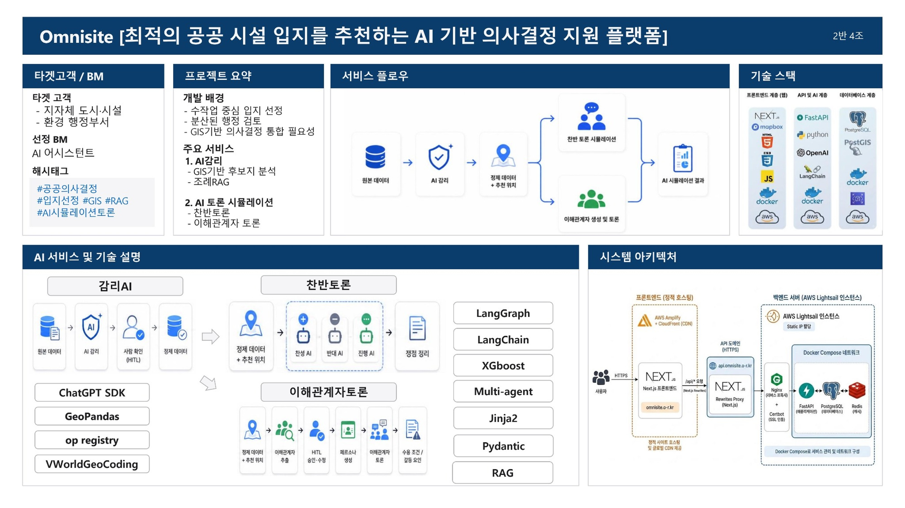
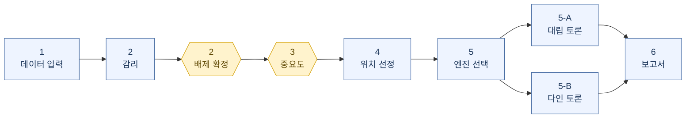

# OmniSite — 프런트엔드

공공시설 입지를 정하고, **왜 그 자리인지 근거를 남기는** 의사결정 지원 플랫폼입니다.
데이터 입력부터 보고서까지 여섯 걸음의 화면으로 이어집니다.

이 저장소는 화면(Next.js)입니다. API는 [백엔드 저장소](https://github.com/popzap/KTAIVLE_BigProject_Back)에 있습니다.



---

## 무엇을 푸는가

흡연부스나 재활용정거장 같은 시설은 필요하다는 데는 동의하지만 내 집 앞은 안 된다는
시설입니다. 담당자가 막히는 지점은 좋은 자리를 못 찾는 게 아니라, **왜 그 자리인지
설명할 수 없다**는 것입니다. 이 저장소는 그 과정을 화면으로 만든 쪽입니다.

시연 도메인은 서울 용산구 흡연부스(MVP), 성동구 재활용정거장(2차)입니다.

---

## 화면 흐름



노란 칸이 **사람이 확정하는 지점(HITL)** 입니다. 한 번 끝까지 지나가면 결재에 쓸 수 있는
문서가 나옵니다.

**1 · 데이터 입력** `/` — 원본 데이터와 조례를 올리거나 프리셋(흡연 · 재활용)을 고릅니다.
처음이면 프리셋이 빠릅니다.

**2~3 · 감리와 중요도** `/audit` · `/audit/exclusion` · `/weights` — AI가 조례를 읽고 배제
조건과 데이터 의도를 제안합니다. **AI는 초안만 내고 확정은 사람이 누릅니다.** 게이트 A는
배제 반경 · 데이터 의도 · 지역 코드를, 게이트 B는 집계 반경과 지표 가중치(−1 ~ +1
슬라이더)를 정합니다. 파이프라인이 그 자리에서 멈춰 사람을 기다립니다. 값마다 누가
정했는지 함께 남습니다.

**4 · 위치 선정** `/sites` — MCLP가 뽑은 Top-N 후보가 지도에 뜹니다. 지도가 있는 유일한
화면입니다.

```
지적도 44,459 필지 → 후보점 66,915 → 생존 56,967 → Top-N 20
```

핵심은 20이 아니라 56,967입니다. 탈락한 후보마다 어느 배제 레이어에 걸렸는지가 남아서
"왜 저기는 아닌가"에 답할 수 있습니다.

> 목록의 `순위`는 점수 내림차순이 아니라 MCLP 커버 기여 순서입니다. 흡연 실측에서
> 4위 0.7793 > 1위 0.7703. 좋은 점 20개가 아니라 **가장 많이 덮는** 20개이기 때문입니다.

**5 · 갈등 예측** `/hearing/select` → `/hearing` 또는 `/dynamic-hearing` — 공청회를 미리
돌려봅니다. 반대를 줄이는 게 아니라 반대의 내용을 미리 아는 것입니다.

| | A · 대립 토론 | B · 다인 토론 |
|---|---|---|
| 구성 | 찬성 · 반대 · 행정 + 평가자 + 보고 | 페르소나 8명 추천 → N명 선택 |
| 보는 것 | 갈등의 축 | 이해관계의 지도 |

두 엔진은 **같은 근거**(화면 4에서 고른 후보점 좌표 · 감리 근거 · 조례 조문 · 주변 POI)를
받습니다. 근거가 갈리면 비교가 불가능하기 때문입니다.

**6 · 보고서** `/report` — 선택과 근거를 PDF · HWPX로 내려받습니다. HWPX에는 QR이 들어갑니다.

---

## 라우트

| 구분 | 경로 | |
|---|---|---|
| 본 흐름 | `/` | 화면 1 · 데이터 입력 |
| | `/audit` | 화면 2 · 감리 |
| | `/audit/exclusion` | 화면 2 · 배제 확정 (게이트 A) |
| | `/weights` | 화면 3 · 중요도 (게이트 B) |
| | `/sites` | 화면 4 · 위치 선정 (지도) |
| | `/report` | 화면 6 · 보고서 |
| 화면 5 분기 | `/hearing` | A · 대립 토론 |
| | `/dynamic-hearing` | B · 다인 토론 |
| 보조 | `/hearing/select` | 엔진 선택 |
| 번외 | `/mypage` · `/posts` | 마이페이지 · 게시판 |
| | `/hearing-pdf` | 고정 표본 미리보기 — 실행 결과가 아닙니다 |
| | `/sentry-example-page` | Sentry 연동 확인용 |

---

## 실행 모드

| 모드 | 뜻 | LLM |
|---|---|---|
| `fixture` | 고정 기준선 재생 | 0회 |
| `hitl` | 프리셋 + 사람이 게이트에서 확정 | 호출 |
| `full` | 업로드 데이터로 STEP0부터 전부 | 호출 |

**처음이라면 `fixture`.** 흡연 기준 약 95초에 화면 5까지 가고, LLM을 부르지 않아 비용이
0이며 값이 매번 같습니다.

<sub>참고 — 실제로 LLM을 부르는 무인 구간 합계는 흡연/용산 316.53초, 재활용/성동
114.33초입니다. 사람이 게이트 앞에서 멈춘 시간은 제외한 값입니다.</sub>

---

## 실행 — 3줄

Node.js 20.9 이상이 필요합니다(Node 24.16 / npm 11.13에서 확인). 백엔드도 떠 있어야
합니다 → [백엔드 저장소](https://github.com/popzap/KTAIVLE_BigProject_Back)

```bash
cd BigProject_Front

cp .env.example .env.local     # Windows: copy .env.example .env.local
npm install
npm run dev
```

→ <http://localhost:3000>

`.env.local`은 키가 하나뿐이고 기본값이 이미 맞습니다.

```
OMNISITE_API_ORIGIN=http://127.0.0.1:8000
```

브라우저는 백엔드 주소를 모릅니다. 같은 출처(`/api/v1/...`)로만 부르고 Next.js rewrite가
넘깁니다. 백엔드를 다른 호스트에 두면 이 한 줄만 바꾸면 됩니다.

> **반드시 `npm run dev`로 띄우세요.** `npm run build && npm start`로 띄우면 화면 5 토론만
> 내 로컬이 아니라 운영 서버로 나갑니다. 터지지 않고 값만 남의 것이 되기 때문에 알아채기
> 어렵습니다.

---

## 오류

| 증상 | 원인 | 처치 |
|---|---|---|
| 화면 1에 「도메인 목록을 못 받았습니다 · 500」 | 백엔드가 안 떠 있음 | 백엔드 기동 → 「다시 시도」 |
| 지표가 전부 0 | 경계 SHP 없음 또는 서울·경기 밖 | 백엔드 README 데이터셋 절 |
| 화면 5가 HTTP 500인데 백엔드는 멀쩡 | 프록시 타임아웃 | 6분으로 늘려 뒀습니다. 그래도 나면 백엔드가 6분을 넘긴 것 |
| 화면 5 토론이 내 로컬이 아닌 운영 서버에서 돎 | `build && start`로 띄움 | `npm run dev`로 |
| `npm install` 실패 | Node 버전 | Node 20.9 이상 |
| dev 서버가 500 `Unexpected token ':'` | dev를 띄운 채 `build`를 돌림 | `.next` 삭제 후 dev 재시작 |

> 백엔드 없이 프런트만 먼저 띄워도 흰 화면이 되지 않습니다. 값을 받아야 하는 자리마다
> 화면 안에 사유와 HTTP 코드를 적습니다. 가짜 값으로 채우지 않습니다.

---

## 기술 스택

Next.js 16.3(Turbopack) · React 19.2 · TypeScript 6 · Tailwind CSS 4 · Sentry ·
배포는 AWS Amplify

지도는 지도 라이브러리 없이 canvas에 직접 그립니다. 의존성과 번들 크기를 늘리지 않으려고
내린 선택입니다.

> 이 버전의 Next.js는 흔히 알려진 그 Next.js가 아닙니다. API·규약·파일 구조가 다를 수
> 있으니 코드를 쓰기 전에 `node_modules/next/dist/docs/`의 해당 가이드를 먼저 읽으세요.

---

## 대체하지 않는 것

법정 절차(주민설명회 · 의회 · 고시), 최종 의사결정, 현장 실사, 이해관계자의 실제 의견은
그대로입니다. OmniSite가 채우는 것은 **후보를 어떻게 골랐는가**의 공백 하나입니다.

프런트 버전은 `0.1.0`, 백엔드는 `1.0.0`입니다. 갈려 있고 통일하지 않았습니다 — "1.0이니
다 됐다"로 읽히면 안 되기 때문입니다.

---

<sub>KT AIVLE 9기 4조 — OmniSite</sub>
