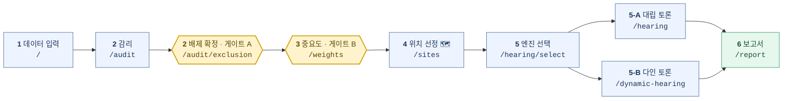
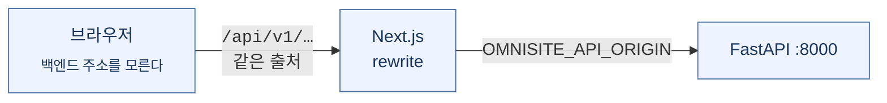

<div align="center">

# OmniSite — 프런트엔드

### 갈등을 **설계 단계에서** 끝내는 공간의사결정지원시스템


**흡연부스를 어디에 놓을 것인가.**
그 질문에 Top-N 좌표와, **나머지 56,947 곳을 왜 안 골랐는지**를 함께 내놓습니다.

이 저장소는 **화면(Next.js)** 입니다 · API 는 → [**백엔드 저장소**](https://github.com/popzap/KTAIVLE_BigProject_Back)

</div>

---

## 📄 한 장 요약

| | |
|---|---|
| **무엇을** | 갈등시설(혐오시설) 입지 선정 B2G 공간의사결정지원 시스템(SDSS) |
| **화면 흐름** | 데이터 입력 → 감리 → 가중치 → 위치 선정 → 갈등 예측 → 보고서 |
| **설계 원칙** | `LLM 이 제안한다 → 결정론 코드가 실행한다 → 사람이 확정한다(HITL)` |
| **사람이 멈추는 곳** | 게이트 **A**(배제 조건) · 게이트 **B**(집계반경 · 가중치) |
| **지도** | 지도 라이브러리 없이 **canvas 직접 렌더링** — `/sites` 한 화면 |
| **처음 볼 때** | `fixture` 모드 — **LLM 0회 · 약 95초**로 화면 5 까지 |
| **시연 도메인** | 서울 용산구 흡연부스(MVP) · 성동구 재활용정거장(2차) |

---

## 1. 무슨 문제를 푸는가

흡연부스, 재활용정거장, 소각장은 **필요하다는 데는 다들 동의하지만 내 집 앞은 안
된다**는 시설입니다. 지자체 담당자가 실제로 막히는 지점은 「좋은 자리를 못 찾는
것」이 아니라 **「왜 그 자리인지 설명할 수 없는 것」** 입니다.

```
   현행 행정 프로세스                    OmniSite
   ──────────────────────────           ─────────────────────────────────
   가용 부지 목록 3곳 내외                지적도 44,459 필지에서 출발
   (담당자 경험 · 재구성)                 → 근거를 남기며 좁힌다

   탈락 사유       기록 없음              탈락 사유   배제 레이어별로 기록
   판단 근거       "의결함" 한 줄          판단 근거   run 단위 전량 보존
   주민 반발       열고 나서 안다          주민 반발   열기 전에 시뮬레이션
```

이 저장소는 그 과정을 **여섯 걸음의 화면**으로 만든 쪽입니다.

---

## 2. 화면 흐름 — 처음 켜면 이렇게 씁니다



한 번 끝까지 지나가면 **결재에 쓸 수 있는 문서**가 나옵니다.

### 1 · 데이터 입력 — `/`

원본 데이터와 조례를 올리거나, 준비된 **프리셋(흡연 · 재활용)** 을 고릅니다.
처음 보는 사람은 프리셋으로 시작하는 게 빠릅니다.

### 2~3 · 감리 · 중요도 — `/audit` · `/audit/exclusion` · `/weights`

AI 가 조례를 읽고 **배제 조건과 데이터 의도를 제안**합니다. 여기가 이 서비스의
핵심입니다 — **AI 는 초안만 내고, 확정은 사람이 누릅니다.**

| 게이트 | 화면 | 사람이 정하는 것 |
|:--:|---|---|
| **A** | `/audit/exclusion` | 배제 반경 · 데이터 의도 · 지역 코드 |
| **B** | `/weights` | 집계 반경 `[R]` · 지표 가중치 `[W]` (−1 ~ +1 슬라이더) |

파이프라인이 「다시 돌려보세요」가 아니라 **그 자리에서 멈춰 사람을 기다립니다**(HITL).
문서에 남는 최종값은 언제나 사람이 누른 값입니다. 가중치도 사람 값과 비평 값을
**α = 0.3** 으로 섞습니다 — 사람 쪽이 0.7 입니다.

> 화면에는 **「이 값을 누가 정했는가」** 가 함께 남습니다
> (`radius_source` · `w_human_source` · `direction_source`).

### 4 · 위치 선정 — `/sites` 🗺️

MCLP 가 뽑은 Top-N 후보가 지도 위에 뜹니다. **지도가 있는 유일한 화면**입니다.

```
   지적도 필지  44,459  ──▶  후보점  66,915  ──▶  ★ 생존  56,967  ──▶  Top-N  20
                                                 (배제 union 1.1107 km² 차감)
```

**핵심은 20이 아니라 56,967 입니다.** 탈락한 후보마다 어느 배제 레이어에 걸렸는지가
남아서, "왜 저기는 아닌가"에 답할 수 있습니다.

> 🔴 목록의 `순위`는 **점수 내림차순이 아닙니다** — MCLP 커버 기여 순서입니다.
> 흡연 실측에서 **4위 0.7793 > 1위 0.7703**. 점수만 보고 정렬하면 다른 점이 나옵니다.
> 좋은 점 20개가 아니라 **가장 많이 덮는** 20개이기 때문입니다.

> 지도는 Leaflet · Mapbox 같은 라이브러리를 쓰지 않고 **canvas 에 직접 그립니다.**
> 의존성과 번들 크기를 늘리지 않으려고 내린 선택입니다.

### 5 · 갈등 예측 — `/hearing/select` → `/hearing` 또는 `/dynamic-hearing`

공청회를 미리 돌려봅니다. 반대를 **줄이는** 게 아니라 반대의 **내용을 미리 아는**
것입니다. 엔진이 둘이라 먼저 `/hearing/select` 에서 고릅니다.

```
┌─────────────────────────────┐   ┌─────────────────────────────┐
│   A · 대립 토론              │   │   B · 다인 토론              │
│   /hearing                  │   │   /dynamic-hearing          │
├─────────────────────────────┤   ├─────────────────────────────┤
│                             │   │                             │
│    ⊕ 찬성     ⊖ 반대         │   │   페르소나를 «생성» 한다      │
│         ╲   ╱               │   │                             │
│        ⊙ 행정               │   │   ○ ○ ○ ○ ○ ○ ○ ○           │
│           │                 │   │   8명 추천 → N명 선택        │
│      ⊚ 평가자                │   │   중요도 A~D · 우선순위 가중  │
│           │                 │   │   절대 수용불가 조건          │
│      ⊛ 보고                 │   │                             │
│                             │   │                             │
│   고정 3역할 + 평가 + 보고   │   │   동적 N인 · 후보지 평가      │
└─────────────────────────────┘   └─────────────────────────────┘
     갈등의 «축» 을 본다                이해관계의 «지도» 를 본다
   쟁점을 날카롭게 좁힐 때        누가 무엇 때문에 반대하는지 펼쳐볼 때
```

두 엔진은 **같은 근거**(화면 4 에서 고른 후보점의 좌표 · 감리 근거 · 조례 조문 ·
주변 POI)를 받습니다. 근거가 갈리면 비교 자체가 불가능하기 때문입니다.

### 6 · 보고서 — `/report`

지금까지의 선택과 근거를 **PDF · HWPX** 로 내려받습니다. HWPX 에는 QR 이 들어갑니다.

---

## 3. 전체 라우트 13개

| 구분 | 경로 | 설명 |
|---|---|---|
| **본 흐름** | `/` | 화면 1 · 데이터 입력 |
| | `/audit` | 화면 2 · 감리 |
| | `/audit/exclusion` | 화면 2 · 배제 조건 확정 — **게이트 A** |
| | `/weights` | 화면 3 · 중요도 — **게이트 B** |
| | `/sites` | 화면 4 · 위치 선정 — **지도** |
| | `/report` | 화면 6 · 보고서 |
| **화면 5 분기** | `/hearing` | A · 대립 토론 |
| | `/dynamic-hearing` | B · 다인 토론 |
| **보조** | `/hearing/select` | 화면 5 엔진 선택 |
| **번외** | `/mypage` | 마이페이지 |
| | `/posts` | 게시판 |
| | `/hearing-pdf` | **고정 표본 미리보기** — 실행 결과가 아닙니다 |
| | `/sentry-example-page` | Sentry 연동 확인용 |

---

## 4. 실행 모드 3종 — API 키가 없어도 끝까지 볼 수 있습니다

| 모드 | 뜻 | LLM 호출 | 언제 |
|---|---|:--:|---|
| `fixture` | 고정 기준선 재생 | **0회** | 시연 · 처음 볼 때 |
| `hitl` | 프리셋 + 사람이 게이트에서 확정 | 호출함 | 게이트를 직접 눌러볼 때 |
| `full` | 업로드 데이터로 STEP0 부터 전부 | 호출함 | 새 지역·새 시설을 넣을 때 |

**처음이라면 `fixture` 로 시작하세요.** 흡연 도메인 기준 **약 95초** 만에 화면 5 까지
갑니다. LLM 을 한 번도 부르지 않아 비용이 0 이고 값이 매번 같습니다.

<sub>참고 — 실제로 LLM 을 부르는 무인 구간 합계(Σsec)는 흡연/용산 **316.53초**,
재활용/성동 **114.33초** 로 측정돼 있습니다. 사람이 게이트 앞에서 멈춘 시간은 제외한 값입니다.</sub>

---

## 5. 실행 — 3줄

> 준비물: **Node.js 20.9 이상** (Node 24.16 / npm 11.13 에서 확인).
> 그리고 백엔드가 떠 있어야 합니다 → [백엔드 저장소](https://github.com/popzap/KTAIVLE_BigProject_Back)

```bash
cd BigProject_Front

cp .env.example .env.local     # Windows: copy .env.example .env.local
npm install
npm run dev
```

열립니다 → **<http://localhost:3000>**

`.env.local` 은 키가 **하나뿐**이고 기본값이 이미 맞습니다:

```
OMNISITE_API_ORIGIN=http://127.0.0.1:8000
```



브라우저는 백엔드 주소를 모릅니다 — 같은 출처로만 부르고 rewrite 가 넘깁니다.
백엔드를 다른 호스트에 두면 **이 한 줄만** 바꾸면 됩니다.

> 🔴 **반드시 `npm run dev` 로 띄우세요.** `npm run build && npm start` 로 띄우면
> 화면 5 토론만 내 로컬이 아니라 **운영 서버**로 나갑니다. 터지지 않고 값만 남의
> 것이 되기 때문에 알아채기 어렵습니다.

---

## 6. 자주 나는 오류

| 증상 | 원인 | 처치 |
|---|---|---|
| 화면 1 에 **「도메인 목록을 못 받았습니다 · 500」** | 백엔드가 안 떠 있음 | 백엔드 기동 → 화면의 **「다시 시도」** |
| 화면은 뜨는데 **지표가 전부 0** | 경계 `.shp` 없음, 또는 서울·경기 밖 지역 | 백엔드 README 데이터셋 절 |
| 화면 5 가 **HTTP 500** 인데 백엔드는 멀쩡 | 프록시 타임아웃 | 이미 6분으로 늘려 뒀습니다. 그래도 나면 백엔드가 6분을 넘긴 것 |
| 🔴 화면 5 토론이 **내 로컬이 아닌 운영 서버**에서 돎 | `build && start` 로 띄움 | **`npm run dev`** 로 |
| `npm install` 실패 | Node 버전 | Node 20.9 이상 |
| dev 서버가 500 `Unexpected token ':'` | dev 를 띄운 채 `build` 를 돌림 | `.next` 삭제 후 dev 재시작 |

> 백엔드 없이 프런트만 먼저 띄워도 됩니다. **흰 화면이 되지 않습니다.** 값을 받아야
> 하는 자리마다 **화면 안에 사유와 HTTP 코드**를 적습니다. 가짜 값으로 채우지 않습니다.

---

## 7. 기술 스택

Next.js 16.3 (Turbopack) · React 19.2 · TypeScript 6 · Tailwind CSS 4 ·
**지도는 의존성 없이 canvas 직접 렌더링** · Sentry · 배포는 AWS Amplify.

> ⚠️ 이 버전의 Next.js 는 흔히 알려진 그 Next.js 가 아닙니다. API·규약·파일 구조가
> 다를 수 있으니, 코드를 쓰기 전에 `node_modules/next/dist/docs/` 의 해당 가이드를
> 먼저 읽으세요.

---

## 8. 우리가 «대체하지 않는» 것

```
   ✘  법정 절차를 대체하지 않는다             — 주민설명회 · 의회 · 고시는 그대로다
   ✘  최종 의사결정을 대체하지 않는다          — 결정은 지자체가 한다
   ✘  현장 실사를 대체하지 않는다             — 지적도는 현장이 아니다
   ✘  이해관계자의 «실제» 의견을 대체하지 않는다 — 시뮬레이션은 예행연습이다
```

OmniSite 가 채우는 것은 **「후보를 어떻게 골랐는가」의 공백** 하나입니다.

> 프런트 버전은 `0.1.0`, 백엔드는 `1.0.0` 입니다. **갈려 있고, 통일하지 않았습니다.**
> 「1.0 이니 다 됐다」로 읽히면 안 되기 때문입니다.

---

<div align="center">

```
┌────────────────────────────────────────────────────────────────┐
│                                                                │
│    OmniSite 는 «좋은 자리» 를 찾는 도구가 아닙니다.              │
│                                                                │
│    «왜 그 자리인가» 와 «왜 저 자리가 아닌가» 에                  │
│    답할 수 있게 만드는 시스템입니다.                             │
│                                                                │
│           Top-N 20 곳  ·  나머지 56,947 곳의 «이유»             │
│                                                                │
└────────────────────────────────────────────────────────────────┘
```

**KT AIVLE 9기 4조 — OmniSite**

[](https://github.com/popzap/KTAIVLE_BigProject_Back)
[](http://localhost:3000)

</div>
